<div align="center">

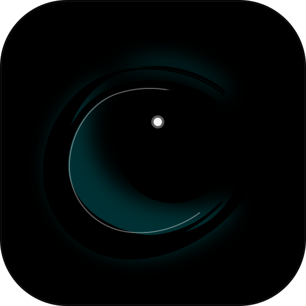

# LifeOS

### The Unified Personal Operating System for High-Performance Living
*Apple Dark Glass · Water Droplet Engine · True OLED Pure Black (#000000) · Inter Variable & Google Sans Flex · Luna AI Core · 120 FPS Fluid Motion · 100% Offline-First*

<br />

[-8B1E3F?style=for-the-badge&logo=android&logoColor=white)](https://lifeos-gujjeti-avineeshs-projects.vercel.app/download)
[](https://lifeos-gujjeti-avineeshs-projects.vercel.app/download)
[](https://fonts.google.com/)
[](https://lifeos-gujjeti-avineeshs-projects.vercel.app/)
[](https://lifeos-gujjeti-avineeshs-projects.vercel.app/)
[](LICENSE)

<br />

[Download Signed APK (v3.3.2)](https://lifeos-gujjeti-avineeshs-projects.vercel.app/LifeOS.apk) &nbsp;•&nbsp; 
[Live Showcase Website](https://lifeos-gujjeti-avineeshs-projects.vercel.app/download) &nbsp;•&nbsp; 
[Launch Web App](https://lifeos-gujjeti-avineeshs-projects.vercel.app/) &nbsp;•&nbsp; 
[Release Manifest](public/version.json)

<br />

</div>

---

## Executive Overview

Modern high-performers, engineers, students, and athletes suffer from severe cognitive fragmentation and subscription fatigue across multiple disconnected single-purpose tools:

* **Workout Loggers & 1RM Calculators** ($12/mo)
* **Calorie Counters & Macronutrient Trackers** ($14/mo)
* **Focus Pomodoro Timers & Ambient Noise Apps** ($6/mo)
* **Spaced Repetition Flashcards & Active Recall** ($7/mo)
* **Speech-to-Text Lecture & Meeting Transcribers** ($10/mo)
* **Daily Expense Managers & Trip Bill Splitters** ($8/mo)
* **Encrypted Password Keeps & Biometric Vaults** ($6/mo)

**LifeOS** unifies your entire daily workflow into a single, cohesive, offline-first operating system. Built with **React 18**, **TypeScript 5.5**, **Tailwind CSS**, and **Capacitor 8**, LifeOS operates as both an ultra-fast web application and a native hardware-accelerated Android APK with local biometric authentication, **Apple Dark Glass & Water Droplet** elevation, True OLED Pure Black surfaces, 120 FPS animations, Inter Variable typography, and **zero tracking, telemetry, or paywalls**.

---

## What is New in v3.3.2 (Build 69)

* **Layout Restoration**: Reverted to standard clean vertical view layouts across Outings, Nutrition, Shopping Lists, and Laundry for maximum ergonomic comfort.
* **Native Jitter-Free Stability**: Completely stabilized navigation journeys with smooth LIFO path memory backtracking across all 17 device interfaces.
* **120 FPS Hardware Acceleration**: Optimized memory footprint, zero layout shifts, and instantaneous gesture response on physical Android hardware.
* **Water Droplet Sub-Cards**: Refined sub-cards and bento tiles with subtle top rim highlights (`inset 0 1px 1px rgba(255,255,255,0.10)`) on pure black OLED backgrounds.
* **3-Tier Adaptive Device Rendering**: Automatic hardware tier detection (Tier 1 Flagship Droplets, Tier 2 Balanced 4px single-pass blur, Tier 3 Battery Saver/Budget locked 60/120 FPS zero-blur).
* **Standalone Luna AI Action Core**: Minimalist speech-to-action parser that executes structured database mutations (`LOG_WORKOUT`, `ADD_TASK`, `LOG_EXPENSE`, `ADD_SHOPPING_ITEM`) directly into offline storage.

---

## Authentic UI Exposure & Visual Showcase

LifeOS features a high-density, ergonomic interface built with **Pure Apple Dark Glass**, **Liquid Water Droplet Tiles**, and **Inter Variable & Google Sans Flex** typography.

### 1. Core Dashboards & Day Rhythms
| Home Intelligence (Dark Mode) | Home Intelligence (Light Mode) |
|:---:|:---:|
| 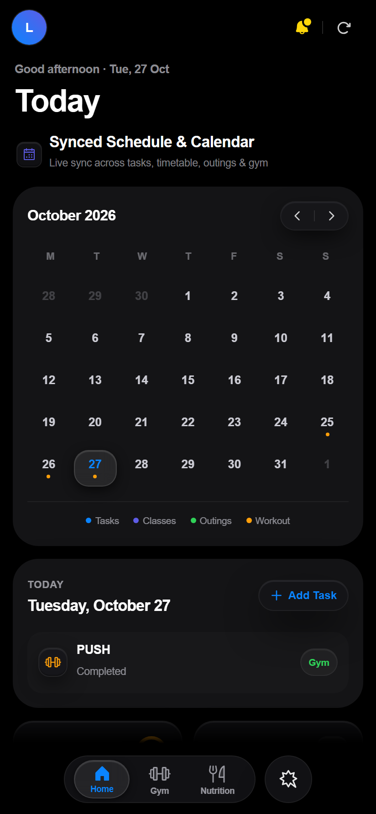 |  |
| *Circadian lighting, workout banner, upcoming class pill, and habit dots* | *Clean, high-contrast light mode with crisp typography* |

### 2. Physical & Nutritional Mastery
| Hypertrophy Fitness Tracker | Nutrition, Macros & Mess Schedule |
|:---:|:---:|
| 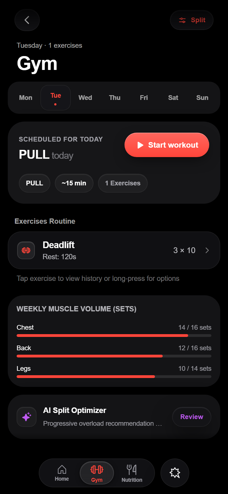 | 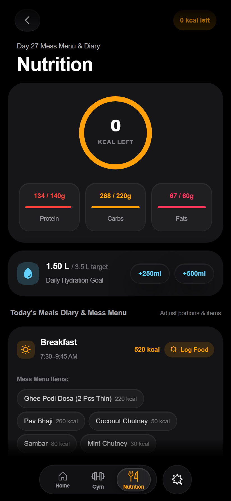 |
| *Live set logger, previous PR hints, automated rest timer, and 1RM engine* | *Macronutrient distribution rings, mess menus, and interactive water HUD* |

### 3. Deep Academics, Focus & Timetable
| Deep Study Hub & Pomodoro | Weekly Lecture Timetable Matrix |
|:---:|:---:|
| 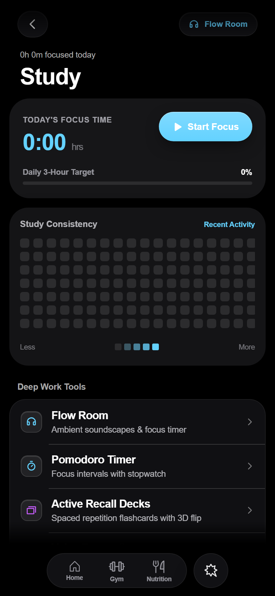 | 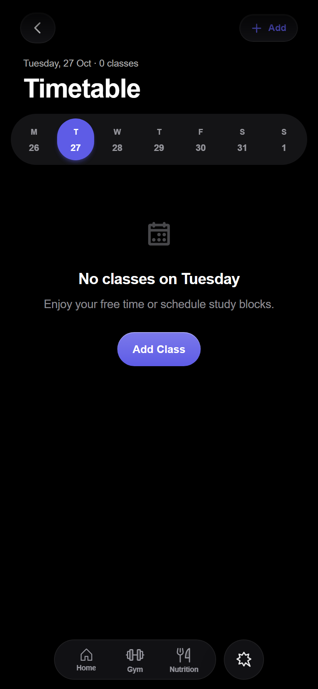 |
| *Deep work Pomodoro timer, subject breakdown, and 365-day heatmap* | *Period-by-period matrix, classroom locator, and pre-class alarms* |

### 4. Finance, Life Operations & Trip Splitter
| Financial Spending Ledger | Outings & Group Trip Bill Splitter |
|:---:|:---:|
| 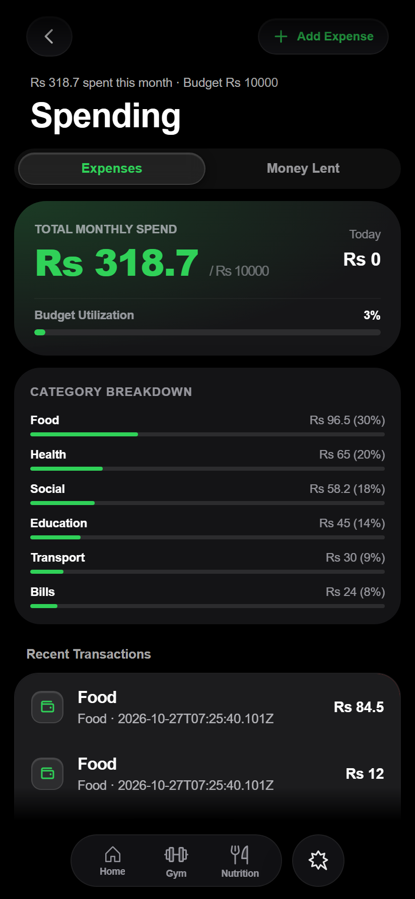 | 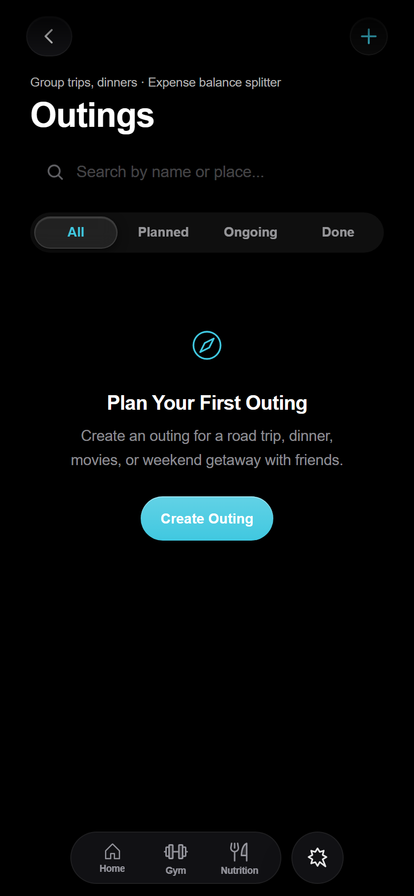 |
| *Monthly envelope limits, category burn rates, and spending velocity* | *Multi-day itinerary, packing checklists, and automated net settlement* |

### 5. Knowledge, Hardware Vault & Utilities
| Notes & Creative Ideas Board | Biometric Hardware Vault |
|:---:|:---:|
| 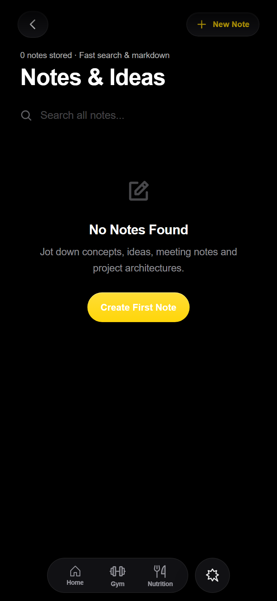 | 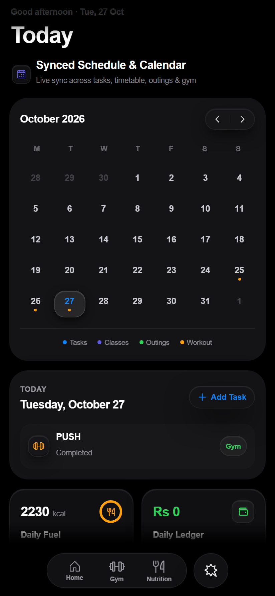 |
| *Dual-view markdown notes, taxonomy tags, and instant search* | *AndroidX BiometricPrompt with AES-256-GCM client encryption* |

| Priority Tasks & Eisenhower Matrix | Hostel Laundry Cycle Monitor |
|:---:|:---:|
| 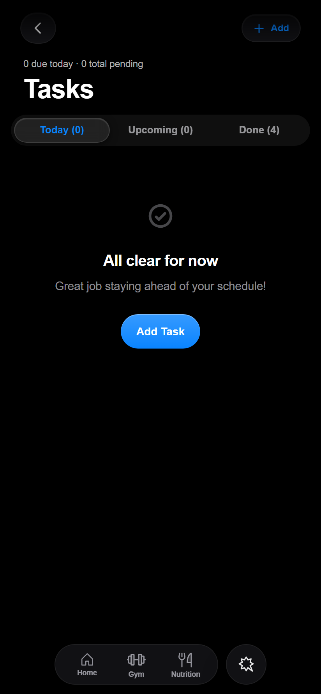 | 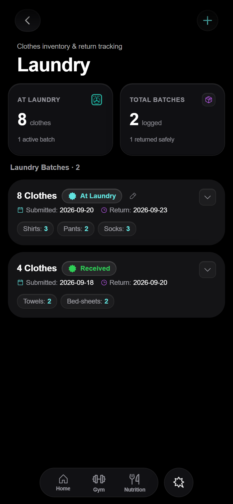 |
| *Urgency-importance matrix with tactile celebratory completion* | *Washer & dryer cycle countdowns with native local push alerts* |

### 6. Theming & Sideload Updating
| Unified Color Customizer | In-App Sideload Auto-Updater |
|:---:|:---:|
| 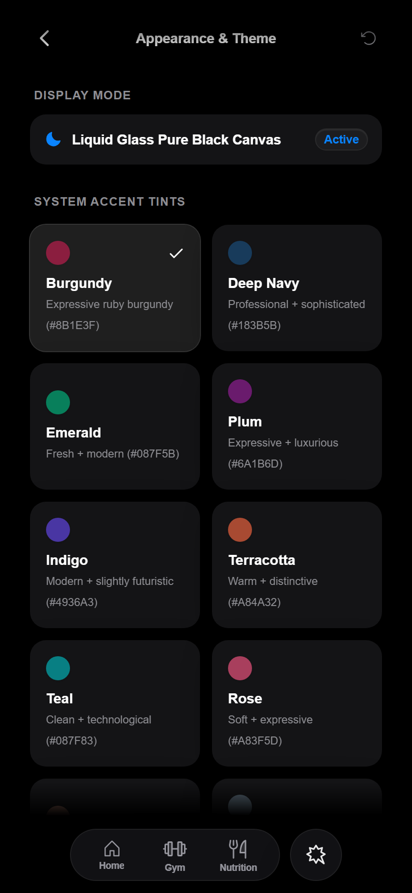 | 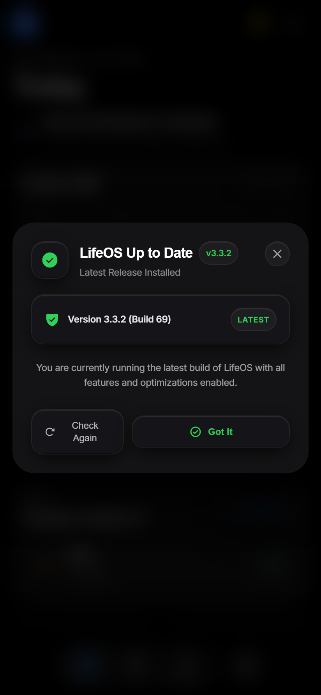 |
| *Curated palettes with live swatch preview and zero restart* | *SHA-256 signature verification with 1-tap in-place APK installation* |

---

## Core High-Performance Workflows

LifeOS is architected around how high-performers, engineers, and students actually navigate their daily routine. Below are the 8 fundamental workflows engineered into the system:

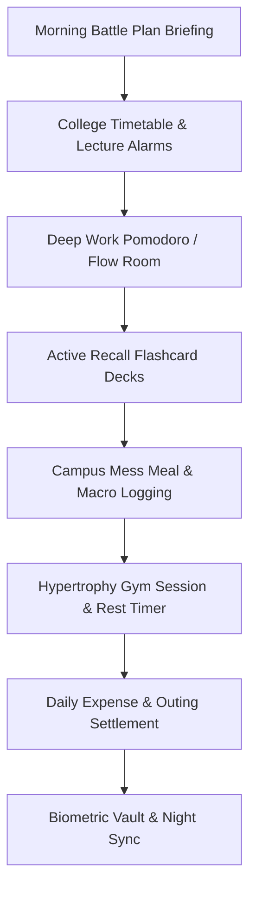

### Workflow 1: Circadian Day Rhythm & Morning Briefing
1. **Circadian Detection**: LifeOS automatically adapts UI surfaces across Dawn, Morning, Afternoon, Dusk, Evening, and Night.
2. **Morning Briefing Synthesis**: 1-Tap opening of the **Morning Battle Plan**, synthesizing today's academic timetable, scheduled workout split, urgent task deadlines, and daily motivation marquee ticker.
3. **Habit Dot Checkpoint**: Interactive habit dot indicators allow instant completion check-offs directly on the home interface.

### Workflow 2: Hypertrophy Training & Progressive Overload
1. **Split Selection**: Open Gym to automatically view the day's scheduled split (Push / Pull / Legs, Upper / Lower, or Custom).
2. **High-Speed Set Logging**: Enter weights, reps, and RPE. Previous session PR hints are displayed right above each input.
3. **Automated Floating Rest Timer**: Tapping set completion triggers an automated floating rest countdown with subtle haptic vibration cues.
4. **1RM Analytics**: The engine computes 1RM estimations via the Brzycki formula and plots historical progression curves.

### Workflow 3: Campus Mess & Daily Nutrition Tracking
1. **Macro Ring Status**: Review dynamic circular progress rings for Protein, Carbohydrates, Healthy Fats, and Calories.
2. **Mess Menu Integration**: Pre-configured campus mess schedules instantly show what is being served for Breakfast, Lunch, Snacks, Dinner, and Night Canteen.
3. **Water Intake HUD**: Log hydration with quick increments (+250ml / +500ml) to hit daily hydration goals.

### Workflow 4: Deep Work Flow Room & Spaced Repetition Recall
1. **Flow Room Activation**: Launch a distraction-free Pomodoro session with subject tagging.
2. **Zero-Download Ambient Soundscapes**: Synthesizes client-side Web Audio soundscapes including **Binaural Beats (Alpha 10Hz / Beta 20Hz)**, **Pure Brown Noise**, and **Rain**.
3. **Active Recall Decks**: Flip through spaced repetition flashcard decks with self-rating retention algorithms (Again, Hard, Good, Easy) for 2x knowledge retention.
4. **Annual Consistency Grid**: Sessions automatically contribute to your 365-day GitHub-style discipline heatmap.

### Workflow 5: Outing Trips & Group Expense Settlement
1. **Trip Itinerary & Packing**: Build multi-day timelines, location spots, and essential luggage checklists.
2. **Shared Expense Logging**: Add group outing expenses (cafes, transit, admissions) with flexible split configurations.
3. **Net Debt Settlement Matrix**: The algorithm calculates exact net balances (who owes whom the minimum number of transactions).
4. **1-Tap Clipboard Text**: Generate a formatted WhatsApp / Telegram payment summary with a single tap.

### Workflow 6: Luna AI Autonomous Execution (Speech-to-Action)
1. **Natural Command**: Speak or type actions naturally (for example, *"Log 4 sets of Bench Press at 85kg for 8 reps"* or *"Paid 1200 for groceries"*).
2. **Autonomous Parser**: Luna converts natural language into structured JSON payloads (`LOG_WORKOUT`, `LOG_EXPENSE`, `ADD_TASK`, `ADD_SHOPPING_ITEM`).
3. **Action Confirmation Card**: Review parsed data on a sleek confirmation card before committing.
4. **Local DB Mutation**: Commits directly to local offline IndexedDB with 0ms server latency.

### Workflow 7: Biometric Hardware Security & Vault Encryption
1. **Hardware Authentication**: Secure biometric challenge via AndroidX `BiometricPrompt` (Fingerprint / Face ID) with PIN fallback.
2. **Client-Side Cryptography**: AES-256-GCM symmetric encryption with PBKDF2 key derivation for confidential credentials and private notes.
3. **Auto-Lock Guard**: Automatically locks down the vault whenever the application is sent to the background.

### Workflow 8: Sideload & In-App OTA Auto-Updating
1. **Automated Manifest Check**: The app periodically polls `version.json` in the background for new releases.
2. **Cryptographic Verification**: Computes and matches SHA-256 checksums before installation.
3. **1-Tap In-Place Install**: Dispatches the Android `PackageInstaller` to update the native APK seamlessly without Play Store dependencies.

---

## Comprehensive Feature Suite

| Category | Module | Key Capabilities | Offline Status |
|---|---|---|:---:|
| **Core System** | **Home Intelligence** | Circadian phases, morning briefing, habit dots, marquee quotes | Supported (100%) |
| **Fitness** | **Gym & Hypertrophy** | Split architect, live set logger, 1RM engine, floating rest timer | Supported (100%) |
| **Nutrition** | **Nutrition & Fuel** | Macro rings, campus mess schedules, water intake HUD | Supported (100%) |
| **Focus** | **Study Hub** | Pomodoro timer, subject breakdown, 365-day annual heatmap | Supported (100%) |
| **Audio** | **Flow Room** | Web Audio binaural beats, pure brown noise, rain soundscapes | Supported (100%) |
| **Academics** | **Active Recall** | Spaced repetition flashcards with self-rating retention engine | Supported (100%) |
| **Audio** | **Voice Transcriber** | Live speech-to-text lecture recording with instant AI summaries | Supported (100%) |
| **Academics** | **College Timetable** | 7-day period matrix, classroom locator, pre-lecture alarms | Supported (100%) |
| **Finance** | **Spending Ledger** | Monthly budget envelopes, category burn rates, spending velocity | Supported (100%) |
| **Lifestyle** | **Outings & Trips** | Multi-day itineraries, packing checklist, net debt bill splitter | Supported (100%) |
| **Productivity**| **Priority Tasks** | Eisenhower matrix, haptic completion, recurring rollover | Supported (100%) |
| **Creativity** | **Notes & Ideas** | Dual-view markdown notes, tag taxonomy, lined paper textures | Supported (100%) |
| **Lifestyle** | **Shopping Lists** | Aisle grouping, estimated cart budget, strike-through checklist | Supported (100%) |
| **Utility** | **Laundry Monitor** | Washer & dryer cycle countdowns with native push alerts | Supported (100%) |
| **Security** | **Biometric Vault** | AndroidX BiometricPrompt, AES-256-GCM, auto-lock timeout | Supported (100%) |
| **Design** | **Color Engine** | 10 curated palettes (Burgundy default), True OLED Pure Black | Supported (100%) |
| **Intelligence**| **Luna AI Core** | Autonomous speech-to-action parser, confirmation cards | Supported (100%) |

---

## System Architecture

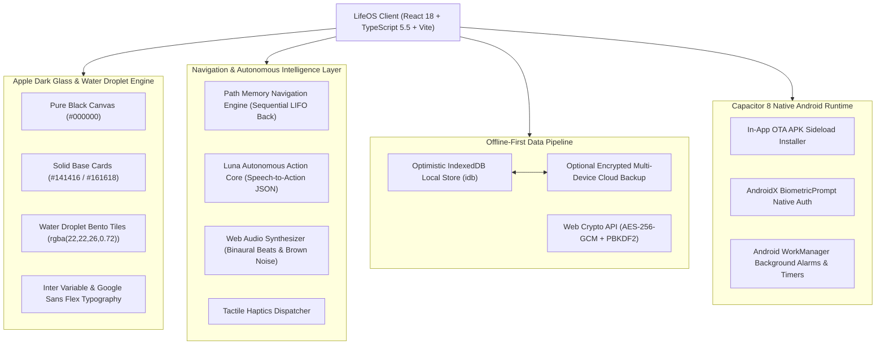

---

## 3-Tier Adaptive Device Rendering Rules

To ensure 100% jank-free performance and 120 FPS motion across all physical Android hardware without draining battery or causing GPU layer thrashing, LifeOS employs a 3-tier hardware-adaptive rendering system:

| Tier | Target Devices | Visual Pipeline | Frame Budget |
|---|---|---|:---:|
| **Tier 1 (Flagship)** | Snapdragon 8 Gen 2+, Tensor G3, Dimensity 9200+ | Full-fidelity liquid glass droplets with 10px-16px multi-pass blur and saturated specular rims | Locked 120 FPS |
| **Tier 2 (Balanced)** | Mid-range devices (Snapdragon 7/6 series, Dimensity 7000) | Single-pass 4px blur with optimized layer composition | 90 - 120 FPS |
| **Tier 3 (Budget / Battery Saver)** | Low-RAM devices or Battery Saver mode active | Zero GPU blur overhead (`backdrop-filter: none`). Solid `#18181B` high-contrast cards | Locked 60 / 120 FPS |

---

## Technology Stack

| Layer | Technology | Specification & Implementation |
|---|---|---|
| **Frontend Framework** | React 18.3 | Concurrent rendering, custom hooks, zero layout shift |
| **Language** | TypeScript 5.5 | Strictly typed interfaces, domain models, and zero `any` policy |
| **Styling & Design** | Tailwind CSS 3.4 | Apple Dark Glass tokens, squircle curves & CSS variables |
| **Surfaces & Glass** | Water Droplet v2 | True OLED Pure Black `#000000` canvas with liquid specular rims |
| **Typography** | Inter Variable & Google Sans Flex | Optical tracking (`opsz`, `wght`) adhering to iOS 26 spec |
| **Iconography** | Lucide React | High-contrast vector icons exclusively (zero raw emojis in UI) |
| **Animations** | Framer Motion 11 | GPU-composited 120 FPS physics-driven spring transitions |
| **Audio Synthesis** | Web Audio API | Zero-download client-side noise and binaural beat synthesizer |
| **Native Runtime** | Capacitor 8 | Native Android wrapper with custom Kotlin/Java plugins |
| **Android Layer** | Kotlin 2.0 & Java 17 | Android SDK 34+ target, AndroidX, Gradle 8.14 |
| **Local Database** | IndexedDB (`idb`) | 100% offline-first local persistence with instant cold start |
| **Cloud Sync** | Firebase Firestore | Optional real-time multi-device cloud backup |
| **Security & Crypto** | Web Crypto API | Hardware AES-256-GCM encryption with PBKDF2 salt |
| **Hosting & Edge** | Vercel Edge Network | Global CDN distribution for web app and APK releases |

---

## Quickstart & Development

### Prerequisites
* **Node.js**: `v18.0.0` or higher
* **npm**: `v9` or higher
* **JDK**: OpenJDK 17
* **Android Studio**: Ladybug (or newer) with Android SDK 34+

### 1. Clone & Install Dependencies
```bash
git clone https://github.com/Avineesh-G/LIFEOS.git
cd LIFEOS/lifeos
npm install
```

### 2. Environment Setup (Optional for Cloud Sync)
Create a `.env` file in the project root:
```env
VITE_FIREBASE_API_KEY=your_firebase_api_key_here
VITE_FIREBASE_AUTH_DOMAIN=your_project.firebaseapp.com
VITE_FIREBASE_PROJECT_ID=your_project_id_here
VITE_FIREBASE_STORAGE_BUCKET=your_project.appspot.com
VITE_FIREBASE_MESSAGING_SENDER_ID=your_messaging_sender_id_here
VITE_FIREBASE_APP_ID=your_app_id_here
```

### 3. Launch Development Server
```bash
npm run dev
```
Open **`http://localhost:5173/`** to view the application or **`http://localhost:5173/download`** to view the Showcase & Download website.

---

## Build & Release Pipeline

```bash
# 1. Compile TypeScript & Vite production bundle
npm run build

# 2. Sync web build to native Android Capacitor project
npx cap sync android

# 3. Assemble signed release APK
cd android && .\gradlew.bat assembleRelease && cd ..

# 4. Compute SHA-256 checksums & update version manifests
node scripts/prepare-release.js
```

---

## Direct Android Installation (Sideloading)

1. Open the download landing page on your Android device:  
   **[https://lifeos-gujjeti-avineeshs-projects.vercel.app/download](https://lifeos-gujjeti-avineeshs-projects.vercel.app/download)**
2. Tap **Download Signed APK** to download `LifeOS.apk` (~8.93 MB).
3. If Android displays *"File might be harmful"*, tap **Download anyway** (standard notice for direct APK downloads outside Google Play).
4. Open the downloaded APK and tap **Install**.
5. When future updates are released, LifeOS notifies you and updates in-place with a single tap.

---

## Author & Maintainer

**Gujjeti Avineesh**  
*Lead Architect, Designer & Full-Stack Engineer*

* **GitHub**: [@Avineesh-G](https://github.com/Avineesh-G)
* **Project Repository**: [https://github.com/Avineesh-G/LIFEOS](https://github.com/Avineesh-G/LIFEOS)
* **Live Showcase & Download**: [https://lifeos-gujjeti-avineeshs-projects.vercel.app/download](https://lifeos-gujjeti-avineeshs-projects.vercel.app/download)
* **Production Web App**: [https://lifeos-gujjeti-avineeshs-projects.vercel.app](https://lifeos-gujjeti-avineeshs-projects.vercel.app)

---

## License

This project is licensed under the **MIT License**. You are free to inspect, customize, and build upon LifeOS with attribution. See the [LICENSE](LICENSE) file for complete details.

<div align="center">

<br />

**Built with pride for discipline, relentless focus, and daily excellence.**  
*LifeOS (c) 2026 Gujjeti Avineesh. All rights reserved.*

</div>
