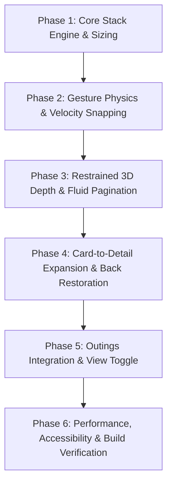

# Premium Horizontal Card Stacking & Navigation — Implementation Specification & Plan

> **Application**: LifeOS  
> **Status**: Ready for Review  
> **Target Platforms**: Android (Capacitor APK / Android WebView) & Desktop Web  
> **Core Libraries**: `framer-motion` (v11), `@use-gesture/react` (v10), `react-router-dom` (v7)  

---

## 1. Executive Summary & Goals

The objective is to redesign relevant card browsing and discovery sections in **LifeOS** around:
1. **Horizontal card stacking** with natural, touch-friendly, finger-tracked gestures.
2. **Subtle perspective & depth** near viewport boundaries (simulating a rotating ring or deck of cards).
3. **Fluid, elastic pagination indicators** that dynamically react to drag distance and velocity.
4. **Seamless card-to-detail transitions** (shared hero geometry expansion and coordinated reverse collapse).
5. **Strict adherence to the LifeOS Performance & Stability Rules** (`AGENTS.md`), preventing frame drops or jank on mobile Android WebViews.

---

## 2. LifeOS System Integration Mapping

### 2.1 Primary Pilot Showcase: Outings (`/outings` & `/outings/:id`)
- **Fit**: The specification emphasizes destination discovery, itinerary/route stops, restaurants, stays, and outing budgets. LifeOS's Outings feature is designed specifically for trips, dinners, and group getaways with places, dates, member counts, and budget tracking.
- **Current State**: Displays a vertical list of `OutingCard` components.
- **Proposed Redesign**:
  - Introduce **Stacked Cards** as the default primary browsing view, with an option to toggle to a compact list if desired.
  - Active outing card sits centered with adjacent cards peeking from the left and right edges.
  - Tapping a card initiates a continuous card-to-detail hero expansion into `/outings/:id`.
  - Pressing back reverses the transition smoothly and restores the previous card index and filter tab (`all`, `planned`, `ongoing`, `completed`).

### 2.2 Reusable Architecture for Future Expansion
The card stack engine will be constructed as a generic, headless UI primitive in `src/ui/stack/`, allowing it to be reused for:
- **Home Routine & Highlights** (`/`): Bento highlights or daily priority cards.
- **Gym Workout Split Explorer** (`/gym`, `/gym/split`): Browsing daily split routines (Push, Pull, Legs, Rest) with active card focus.

---

## 3. Strict Performance & Stability Guardrails (Android WebView / Capacitor APK)

Per the mandatory rules in [`AGENTS.md`](file:///d:/My-Projects/lifeos/AGENTS.md), this implementation adheres to the following non-negotiable constraints:

| Guardrail | Requirement | Implementation Strategy |
| :--- | :--- | :--- |
| **Animation Properties** | **Only `transform` and `opacity`** | No animation of `height`, `width`, `top`, `left`, `margin`, `padding`, `box-shadow`, or `filter`. Card-to-detail transitions will use matrix/scale transforms. |
| **Filter & Blur Prohibition** | **No `backdrop-filter` or `filter: blur()`** | Use opaque or semi-opaque solid glass tokens (`rgba(28, 28, 30, 0.95)`, `glass-card` base). Prevents GPU compositor layer bloat. |
| **GPU Memory Hygiene** | **No permanent `willChange`** | Only apply `will-change: transform` while a drag or spring is active; remove it immediately once settled. |
| **Touch Isolation** | **`touch-action: pan-y` & `manipulation`** | Allow natural vertical page scroll while intercepting horizontal swipes cleanly. Apply minimum gesture threshold (8px) before claiming gesture. |
| **No Body Observers** | **No synchronous `MutationObserver`** | Avoid global DOM listening. Use direct React state and event-driven updates. |
| **Reduced Motion** | **Accessibility Fallback** | Use `useReducedMotion()`; replace 3D springs with instant transitions or simple opacity cross-fades when enabled. |

---

## 4. Component Architecture

```
src/ui/stack/
├── types.ts                      # Interfaces, spring config tokens, gesture states
├── useStackGestures.ts           # Drag tracking, velocity detection, spring settling math
├── HorizontalCardStack.tsx       # Viewport manager, dynamic sizing, neighbor peeking
├── StackCard.tsx                 # 3D perspective, scale, opacity, click suppression
├── FluidPagination.tsx           # Elastic morphing pill/dot indicator
├── CardDetailTransition.tsx      # Shared layout coordinate expand/collapse coordinator
└── index.ts                      # Clean barrel export

src/features/outings/
└── components/
    └── OutingStackCard.tsx       # Premium visual card styled for stacked presentation
```

### Component Responsibilities

### 4.1 `HorizontalCardStack<T>`
- **Container Geometry**: Measures viewport width and calculates card width and neighbor peek dynamically (e.g. 20–32px peek, responsive).
- **Index Management**: Tracks `activeIndex`, clamped strictly to `[0, items.length - 1]`.
- **Keyboard & Touch Accessibility**: Supports `ArrowLeft` / `ArrowRight` navigation, `role="region"`, `aria-roledescription="carousel"`, and accessible item labels.

### 4.2 `useStackGestures`
- Uses `@use-gesture/react` or Framer Motion drag gestures to capture horizontal deltas.
- **Velocity Snapping**:
  - High velocity (> 0.5 px/ms): advances to next/previous card even if drag distance was short.
  - Moderate velocity: snaps to nearest card based on 35% distance threshold.
- **Click Guard**: Suppresses child `onClick` events whenever a drag displacement exceeds 6px, preventing accidental clicks when releasing a swipe.

### 4.3 `StackCard`
- Computes normalized offset `delta = itemIndex - (activeIndex + currentDragOffset / cardWidth)`.
- **Interpolation Values**:
  - **Scale**: `1.0` (active) → `0.92–0.94` (adjacent) → `0.85` (distant).
  - **3D Rotation**: Subtle Y-axis rotation (±2.5° to 4°) directed inward toward the center.
  - **Opacity**: `1.0` (active) → `0.80` (adjacent) → `0.40` (distant).
  - **Depth**: Viewport wrapped in `perspective: 1000px`.

### 4.4 `FluidPagination`
- Renders an active indicator pill alongside neighboring dots.
- **Elastic Stretching**: As the user drags, the active pill stretches horizontally toward the swipe direction proportional to drag offset.
- **Magnetic Settling**: Snaps cleanly into the new dot on release using Framer Motion springs.
- Dot taps allow direct jumping to any index.

### 4.5 `CardDetailTransition`
- Coordinates seamless expansion from the stacked card into the detail screen (`/outings/:id`).
- Matches originating card bounds with detail hero container using Framer Motion `layoutId` or coordinate bounding boxes.
- Smoothly reveals supplementary content (breakdown, expense list, participants) without jarring layout shifts.
- Coordinates reverse navigation to restore exact carousel index and filters.

---

## 5. Phased Implementation Roadmap



### Phase 1: Core Horizontal Stack & Geometry
- Create `src/ui/stack/types.ts`.
- Build `HorizontalCardStack.tsx` with responsive layout sizing, neighbor peeking, and basic index tracking.
- Validate horizontal drag on mobile touch and desktop pointer.
- **Criteria**: Carousel displays active and adjacent cards correctly; dragging moves cards without layout overflow.

### Phase 2: Gesture Physics & Velocity Snapping
- Implement `useStackGestures.ts`.
- Add velocity-aware spring snapping (`stiffness: 380, damping: 32`).
- Prevent drag-to-click bleed (ensure buttons inside cards only fire on true taps).
- Ensure vertical page scrolling is uninterrupted (`touch-action: pan-y`).
- **Criteria**: Fast swipes flick smoothly to next/prev card; slow drags snap predictably to nearest midpoint; zero accidental clicks.

### Phase 3: Restrained 3D Depth & Fluid Pagination
- Add continuous interpolation for `scale`, `rotateY`, and `opacity` in `StackCard.tsx`.
- Build `FluidPagination.tsx` with elastic indicator stretch.
- Connect keyboard arrow keys and accessibility attributes.
- **Criteria**: Cards show subtle 3D perspective near edges without text distortion; pagination stretches and snaps dynamically.

### Phase 4: Card-to-Detail Expansion & Reverse Transitions
- Implement `CardDetailTransition.tsx`.
- Connect `OutingStackCard` to `OutingDetailPage`.
- Animate card bounds into full-screen detail view.
- Handle reverse back navigation, restoring originating carousel index, search queries, and status filter.
- **Criteria**: Selecting a card seamlessly morphs into the detail page; pressing back returns to the exact originating card.

### Phase 5: Outings Feature Integration
- Create `src/features/outings/components/OutingStackCard.tsx`.
- Update `src/features/outings/pages/OutingsListPage.tsx`:
  - Integrate `HorizontalCardStack` as the primary browsing experience.
  - Add view switcher icon button (Stack vs. List view).
  - Retain full search and segmented status filters seamlessly across both views.
- **Criteria**: Outings browsing looks and feels like a top-tier native iOS/Android experience with complete filter and search support.

### Phase 6: Stability Verification & Performance Auditing
- Verify against Android WebView rules (no `backdrop-filter`, only `transform`/`opacity`).
- Run `tsc --noEmit`, `eslint`, and `npm run build` (`vite build`).
- Verify zero runtime console errors across Home, Outings, and Detail pages.
- **Criteria**: Production build succeeds; zero TypeScript errors; 60/120fps smooth performance on mobile viewports.

---

## 6. Files to be Created & Modified

| File Path | Action | Description |
| :--- | :--- | :--- |
| `src/ui/stack/types.ts` | **Create** | TypeScript interfaces for stack items, gestures, and animations |
| `src/ui/stack/useStackGestures.ts` | **Create** | Touch & pointer tracking, velocity calculation, and spring physics hook |
| `src/ui/stack/HorizontalCardStack.tsx` | **Create** | Viewport container with responsive peeking and index management |
| `src/ui/stack/StackCard.tsx` | **Create** | 3D depth, rotation, scale interpolation, and click suppression wrapper |
| `src/ui/stack/FluidPagination.tsx` | **Create** | Morphing/elastic pagination indicator |
| `src/ui/stack/CardDetailTransition.tsx` | **Create** | Shared transition coordinator between card and detail views |
| `src/ui/stack/index.ts` | **Create** | Barrel export for the stack component package |
| `src/ui/index.ts` | **Modify** | Export stack primitives to the global UI system |
| `src/features/outings/components/OutingStackCard.tsx` | **Create** | Premium card component tailored for stacked presentation |
| `src/features/outings/pages/OutingsListPage.tsx` | **Modify** | Integrate HorizontalCardStack with view switch and state preservation |
| `src/features/outings/pages/OutingDetailPage.tsx` | **Modify** | Support incoming card-to-detail expansion and reverse back transition |

---

## 7. Verification & Acceptance Checklist

- [ ] **Responsive Peeking**: Cards are centered and adjacent cards peek 20–32px on both mobile and desktop screens.
- [ ] **Velocity Snapping**: Quick flick advances one card; slow drag snaps cleanly to closest card.
- [ ] **Zero Accidental Clicks**: Swiping a card never triggers navigation to the detail page.
- [ ] **Vertical Scroll Unhindered**: Vertical page scrolling is never blocked when touching the carousel.
- [ ] **Fluid Indicator**: Pagination indicator stretches elastically in real-time during drags and snaps into position.
- [ ] **Subtle Depth**: 3D rotation and scale remain subtle and elegant; text remains crisp and readable at all times.
- [ ] **Card-to-Detail Continuity**: Tapping a card smoothly expands into the detail view without layout flashing.
- [ ] **State Restoration**: Navigating back restores the active carousel index and filter tab.
- [ ] **Performance Compliance**: No `backdrop-filter` or layout reflows; strictly GPU `transform` and `opacity`.
- [ ] **Type & Build Check**: `tsc --noEmit` and `npm run build` pass with zero warnings or errors.
